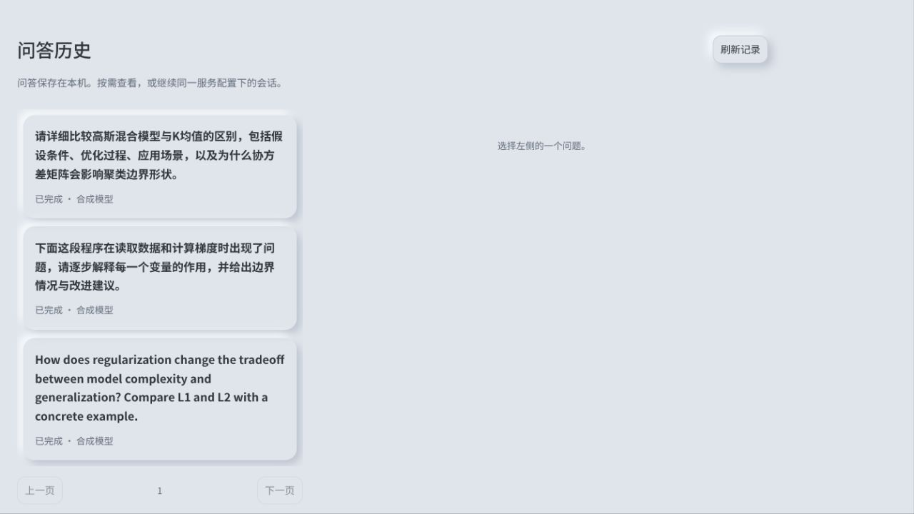

# 历史卡片增大

第3项：历史列表由220px改为至少280px/38%列宽，标题16px加粗、最多4行（原2行），卡片间距与高度增加，保留分页/滚动；720px以下上下排列，列表高度上限360px。悬停可查看最多240字符摘要。

后端原substr(prompt,1,80)改为有界240个Unicode字符，不改存储原问题、不迁移数据库、不改变会话上下文。新增长中文/emoji回归先失败后通过；journal/context共6项通过，前端158通过，Svelte0错误0警告，Vite通过，独立审查无重要问题。浏览器用真实HistoryPanel与合成问题检查，非读取用户历史；未调用真实模型。普通构建/安装状态见development-progress。

