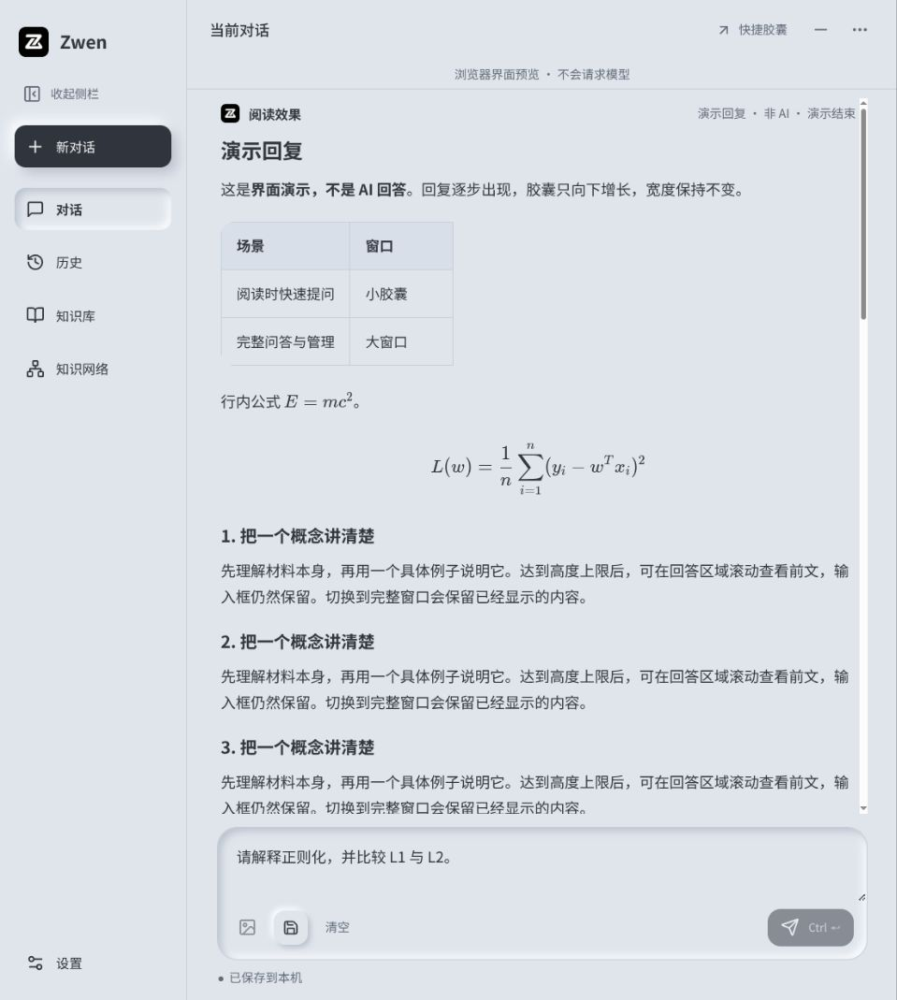
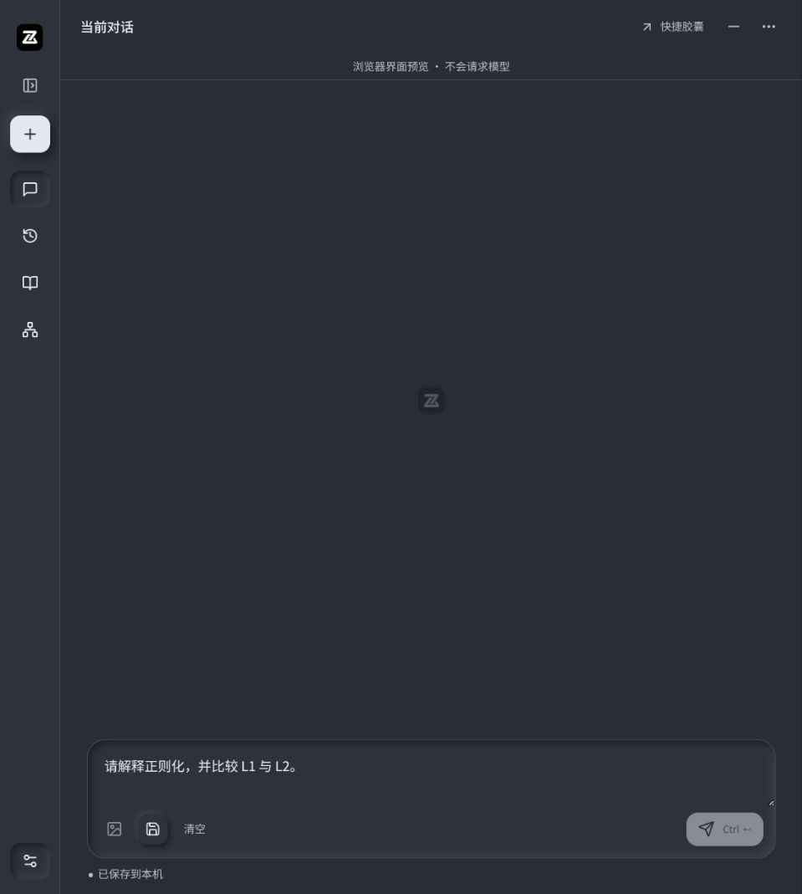
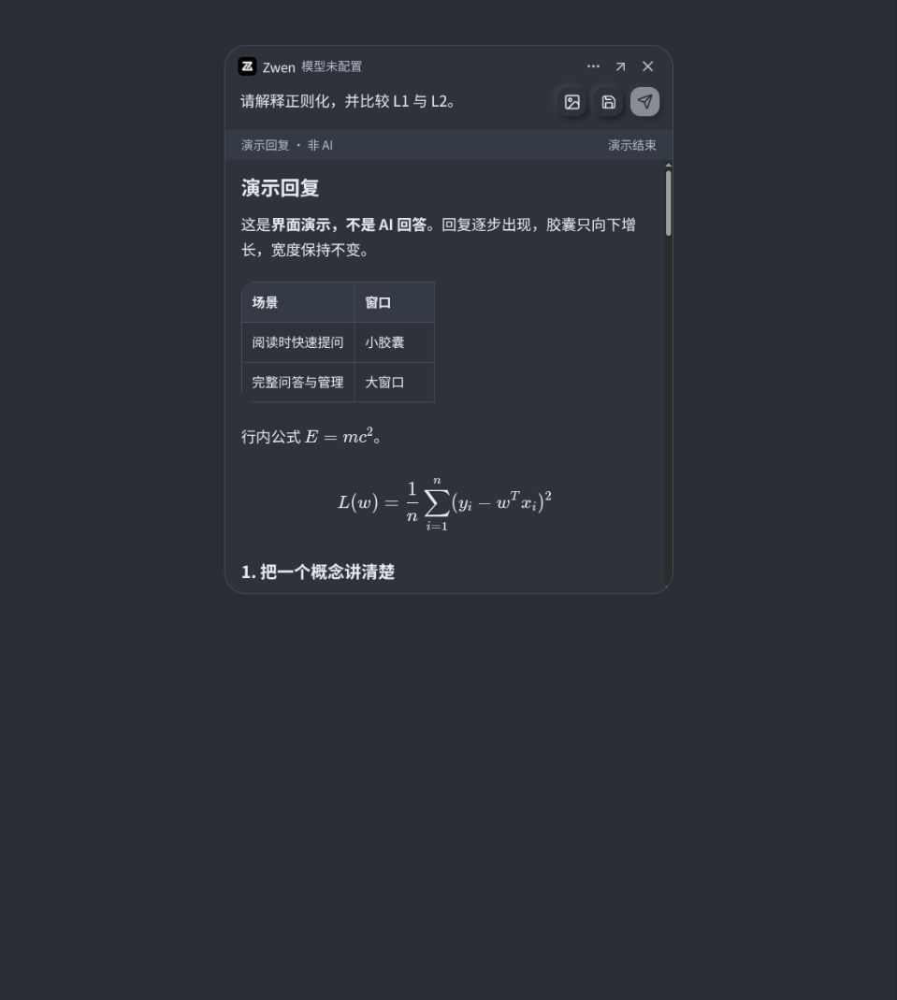
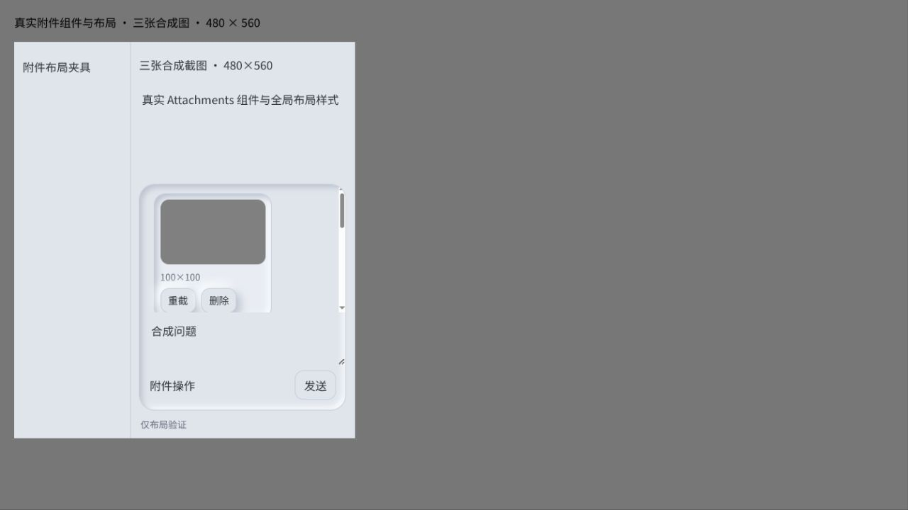

# 2026-11-04 中性新拟物工作台验证

用户已批准第一张布局、可收起侧栏、设置中的浅深主题；两种主题都禁止紫色。UI用现有Svelte实现，未引入UI框架、在线字体或新运行时依赖。官方Lucide0.468.0图标随包提供，来源与许可证在frontend/assets/icons。

## 已实现

- 主窗口工作台：新对话、对话、历史、知识库、知识网络和设置；侧栏可折叠为有可访问标签和提示的图标栏。
- 主窗口、胶囊、子页面和原生划词条使用中性浅深主题。浅色深灰图标，深色浅灰图标；统一圆角与阴影、正文16px，减少装饰文案，演示移入更多菜单且标明非AI。
- 外观偏好原生保存在独立appearance.sqlite3，启动注入安全枚举值；不迁移模型、聊天或草稿数据库。浏览器预览只用该来源localStorage的外观偏好。
- 偏好写入串行化，快速变更保留最新值；写失败回退，加载失败不覆盖原文件；重载期间禁止修改，避免旧读取覆盖新偏好。原生拒绝异常schema、符号链接、非普通文件、非法枚举。
- 多截图附件及输入区设滚动上限，窄窗口仍可到达发送控件。

## 验证证据

- 前端27个测试文件、154项通过；Svelte0错误0警告；Vite普通构建通过。Vite提示单个JS压缩包约506KB，未据此声称内存或性能验收。
- Rust完整workspace release测试通过，桌面49通过、0失败、1ignored；HTTP/重试及core其余测试全部通过。原有organize_job.rs未使用变量警告仍在，rustfmt本机未安装。
- 外观控制器重载竞态先添加回归测试，观察失败，再修复至通过；主窗口集成测试验证折叠、主题切换和导航不丢草稿。
- 两个隔离桌面进程：第一个通过实际UI切深色并折叠、保存合成草稿；第二个启动验证主题、侧栏和草稿均恢复。没有请求模型。
- actions桌面驱动通过：8次本机合成服务请求；10次命令各仅一次窗口呈现；原文入稿/末尾光标、关闭清理、扩展保留、普通草稿所有权、停止退避、部分正文失败保留、翻译解释、文档保存幂等均通过。新增可见划词条换主题后ID/宽高/窗口generation保持；此检查证明状态及几何稳定，不单独证明渲染像素颜色。
- 图片桌面驱动通过：3次请求、2个逻辑问答；429后材料保留，成功才消费，后续文字问题无旧图。
- 胶囊桌面驱动通过：Niri实际浮窗宽480，高约97→401→792；顶部坐标不变，超长内容滚动，展开保留草稿/回答，旧resize不会影响完整窗口。
- CUA浏览器实际查看：浅深主题、折叠/展开、刷新记忆、胶囊菜单、表格和数学公式、回复滚动；480×560真实前端检查。三张合成图另用真实Attachments组件/同一全局CSS的布局夹具验证滚动和发送区可达；此夹具不代表三图端到端截图服务验收。
- 普通无desktop-smoke构建已启动临时数据实例，Niri确认其自身窗口；进程树6进程，一次空闲PSS263.55MiB。仅一次空闲采样，不代表真实模型、大知识图或长期稳定/峰值内存。

截图为实际浏览器前端与合成内容：

## 审查与边界

独立审查提出两个P2：附件无限换行导致发送区溢出；偏好重载竞态。均修补，二次审查无剩余重要问题。初次依赖软链导致Vitest跨路径mock失败，改为本地reflink副本后通过；一次工具shell缺Node路径，使用随附Node后检查通过，均非产品运行失败。

本轮未读取生产数据库、进程环境或密钥，未调用真实模型或上传用户材料。CUA不提供可用原生桌面输入，本轮原生流程属于隔离应用驱动，视觉鼠标操作在共用前端浏览器完成；未宣称真人跨应用划词、所有多屏定位或长期不崩溃均已验收。保留原有快选区/关闭/重试行为，截图快捷键仍Shift+Alt+S。

普通二进制SHA256：f0fe1f3f314d4d9ceb54f6bd9ad37d2ed6474d9edda7b488b3d9084fde2ea259。安装与分支状态见development-progress最新条目。
