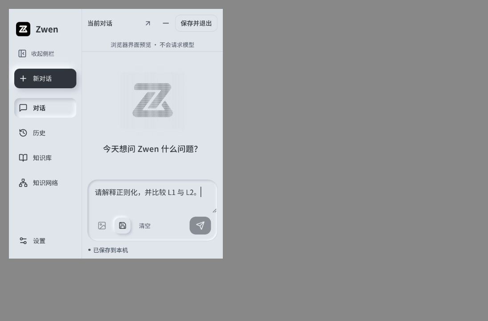

# 直接保存并退出

用户要求的三点菜单删除已完成：主窗口右上角直接显示“保存并退出”，复用原leave(true)保存/停止/退出流程，处理过程中禁用重复点击。“模型回复”仍可通过侧栏“对话”返回。

前端158项通过，Svelte0错误0警告，Vite及Rust普通release构建通过；独立审查无重要问题。原生foundation隔离edit/restore/quit通过；quit模式真实点击新按钮，紧接未保存编辑后执行，Python确认进程正常退出且数据库保留最后追加文字。测试不再由harness退出事件代替按钮。浏览器480×560真实共用前端确认按钮直接可见且无三点菜单。

测试只用临时库和合成文字，没有真实模型调用、用户生产库读取、密钥读取或真实历史删除。原生为应用内驱动，不声称真人鼠标验收。普通无desktop-smoke产物SHA256：636f0f91feb68fa4741f49c5ac8dbe06110980bed2df20ccac820b527075244e；安装状态见development-progress。

