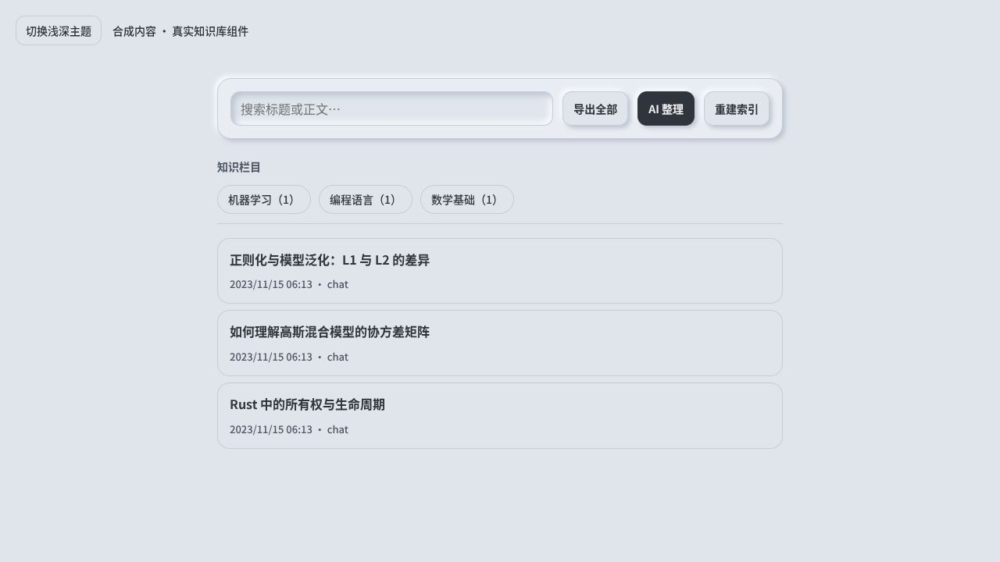
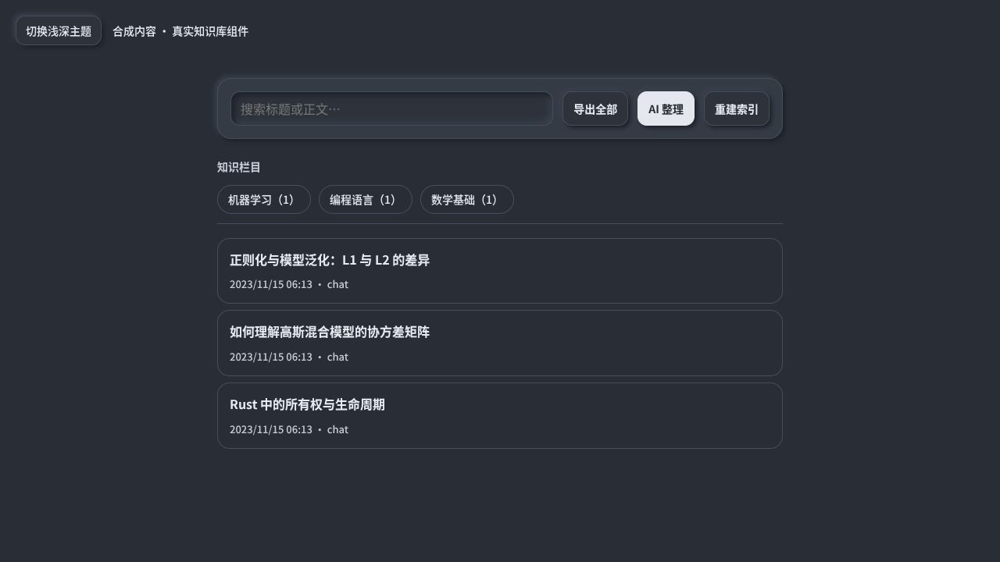
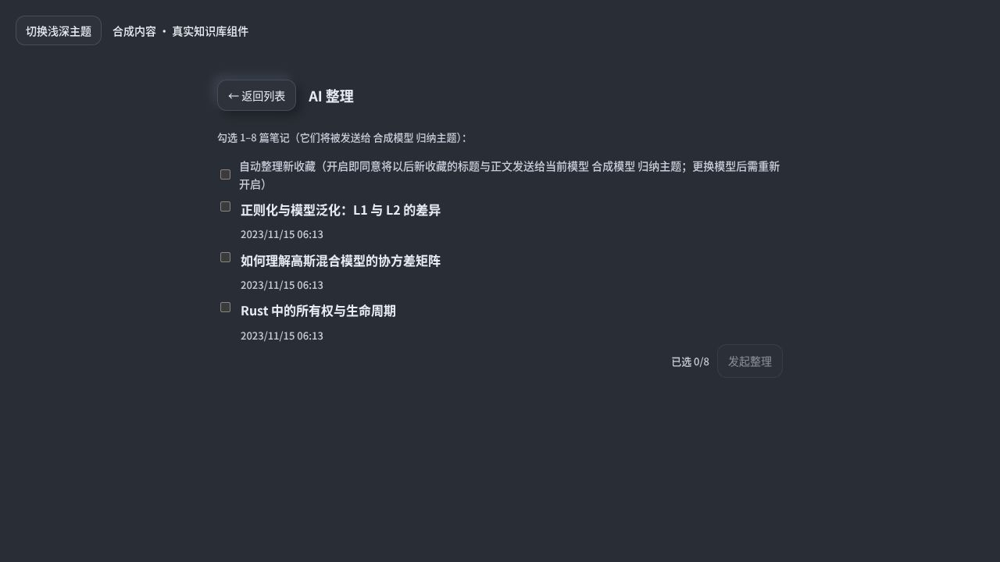
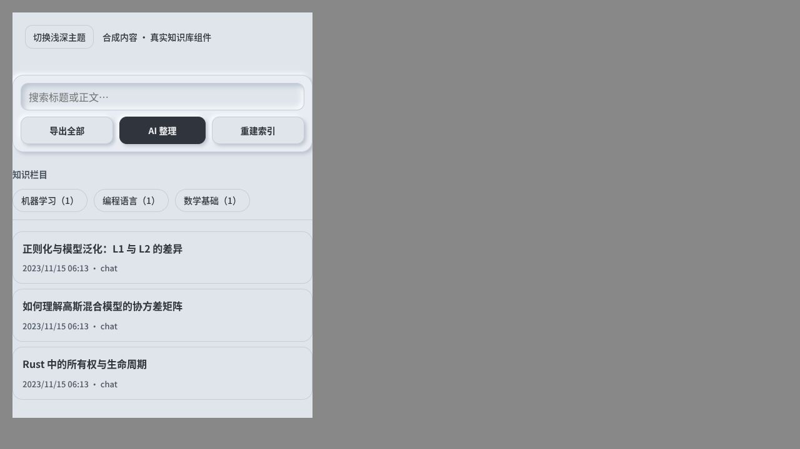

# 小字清晰度与知识库层级

第6/8项：保留本机字体与中性浅深主题，提高辅助文字对比与适度字重。浅色辅助色#4d5663对底色#e0e5ec约5.87:1；深色#c5cdd9对#353b45约7.04:1（只针对这两组实色，不声称全应用已做可访问性验收）。停用按钮仍保持停用样式，不下载商业字体。

知识库搜索/导出/AI整理/索引置于独立凸起工具区，AI整理为主操作；下方知识栏目另行标记，使用平面胶囊筛选。整理页标题和返回按钮、工具行采用垂直居中与统一行高，窄视口允许换行。事件、数据和上传确认行为不变。

前端158项、Svelte0错误0警告、Vite通过；原生合成knowledge回归（保存/搜索/编辑/导出/整理/撤销/栏目管理）通过；行高变化后的胶囊HTTP流式几何再测通过，宽480、高96到792，表格/公式/滚动与草稿转移通过。独立审查无重要问题。浏览器使用真实组件、合成笔记验证浅/深/480宽与整理标题对齐；不冒充真人桌面或真实模型验收。普通构建与部署状态以development-progress为准。

