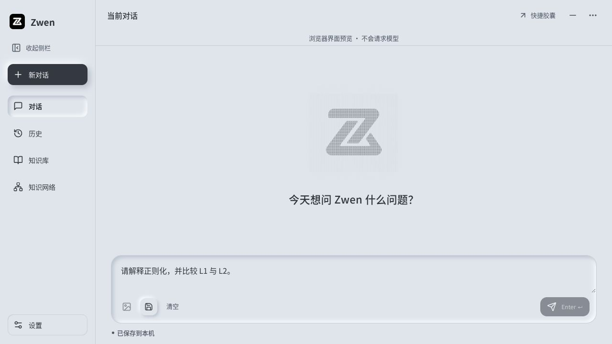
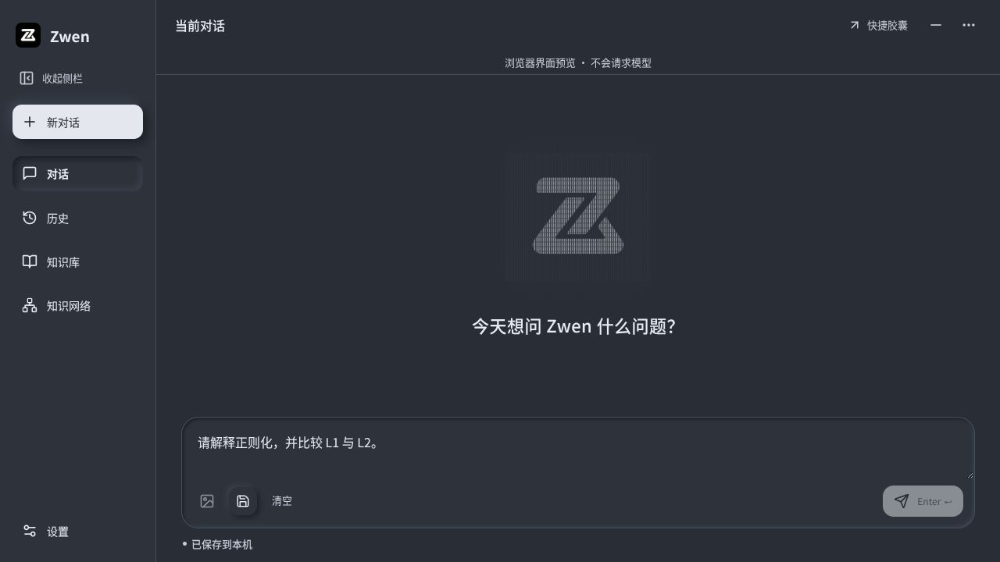

# 磁场纹理欢迎页

第5项：空白对话页使用较大的Zwen原图轮廓，以竖向细条纹和细网格呈现磁场/量化纹理；配“今天想问 Zwen 什么问题？”。复用本机256px图标作为SVG亮度遮罩，无原图改写、动画、持续计时器、网络字体或新依赖，使用主题颜色。窄视口有尺寸上限，装饰SVG对辅助技术隐藏，问候语可读。

用户给定参考图和文字已明确风格，直接实作；下图为真实浏览器共用前端实现，非图片生成稿、非真实模型回答。浅深主题切换与草稿保留已实际检查。前端158项、Svelte0错误0警告、Vite通过，独立审查未发现重要问题。最终普通桌面构建与安装由development-progress记录；本轮不声称真人跨应用或长期稳定验收。

